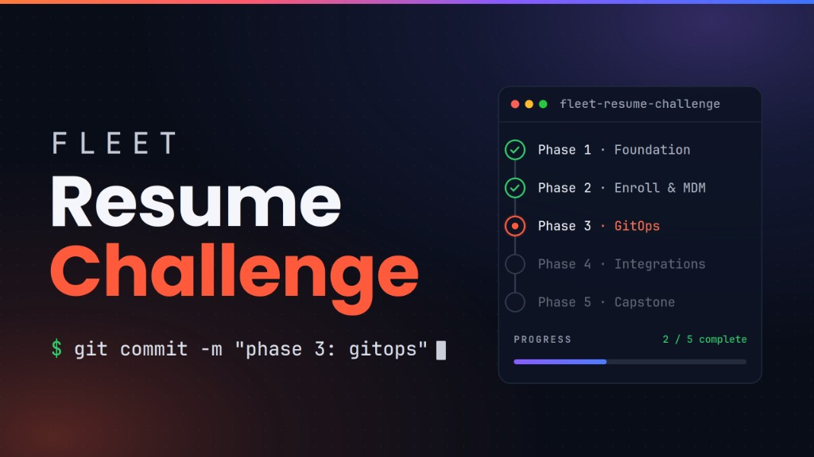

# The Fleet Resume Challenge

The Fleet Resume Challenge is inspired by the [Cloud Resume Challenge](https://cloudresumechallenge.dev/),
but built around [Fleet](https://fleetdm.com/docs/get-started/why-fleet), the open-source platform for device management. 

Work through 16 core hands-on modules (plus optional bonus modules): deploy Fleet, enroll hosts,
configure MDM, manage your configuration with GitOps, run osquery, and more.

Put the skills you learn during the challenge on your resume and use the experience to help land a job as a Client Platform Engineer.

## What you'll build

- A live Fleet server you deployed and own end-to-end
- Hosts enrolled across multiple platforms: macOS, Windows, Linux (iOS and Android optional)
- Policies, software deployments, and configurations all managed as code with GitOps
- A published blog post describing what you learned

## Who it's for

- IT professionals preparing for Client Platform Engineering or Device Management roles
- Anyone breaking into endpoint management who wants hands-on, provable experience
- Fleet users who want to go deeper than the docs

## How it works

1. Work through the [challenge](challenge.md)
2. Publish a [blog post](modules/15-blog-post.md)
3. Put Fleet on your [resume](guides/resume.md)

## Get started

→ [Read the FAQ](faq.md)  
→ [Take the challenge](challenge.md)

## Project status

This challenge is a work in progress. The checklist below shows which modules are ready to use today.

- **Ready** = content written, proofread, and validated
- **Minimal** = a minimal foundation so you can see where we're going; the plan has not yet been validated

### Core modules

| Module | Status |
|--------|--------|
| [0. Get oriented](modules/0-get-oriented.md) | ✅ Ready |
| [1. Deploy Fleet](modules/1-deploy-fleet.md) | ✅ Ready |
| [2. Enroll hosts](modules/2-enroll-hosts.md) | ✅ Ready |
| [3. Fleets & labels](modules/3-fleets-and-labels.md) | ✅ Ready |
| [4. GitOps](modules/4-gitops.md) | ✅ Ready |
| [5. Host data & queries](modules/5-host-data-and-queries.md) | 🐣 Minimal |
| [6. Policies](modules/6-policies.md) | 🐣 Minimal |
| [7. Software](modules/7-software.md) | 🐣 Minimal |
| [8. MDM](modules/8-mdm.md) | 🐣 Minimal |
| [9. OS settings](modules/9-os-settings.md) | 🐣 Minimal |
| [10. Disk encryption](modules/10-disk-encryption.md) | 🐣 Minimal |
| [11. OS updates](modules/11-os-updates.md) | 🐣 Minimal |
| [12. Certificates](modules/12-certificates.md) | 🐣 Minimal |
| [13. Setup experience](modules/13-setup-experience.md) | 🐣 Minimal |
| [14. Vulnerability management](modules/14-vulnerability-management.md) | 🐣 Minimal |
| [15. Blog post](modules/15-blog-post.md) | ✅ Ready |

### Bonus modules

| Module | Status |
|--------|--------|
| [Bonus 1. SIEM](modules/bonus-1-siem.md) | 🐣 Minimal |
| [Bonus 2. Webhooks](modules/bonus-2-webhooks.md) | 🐣 Minimal |
| [Bonus 3. Conditional access](modules/bonus-3-conditional-access.md) | 🐣 Minimal |
| [Bonus 4. AI + Fleet](modules/bonus-4-ai-fleet.md) | 🐣 Minimal |

## Contributing

Contributions are welcome. Open an issue or pull request with improvements, fixes, or new module
ideas. See the [open issues](../../issues) for what's currently in progress.

## License

This project is licensed under the [MIT License](LICENSE).
